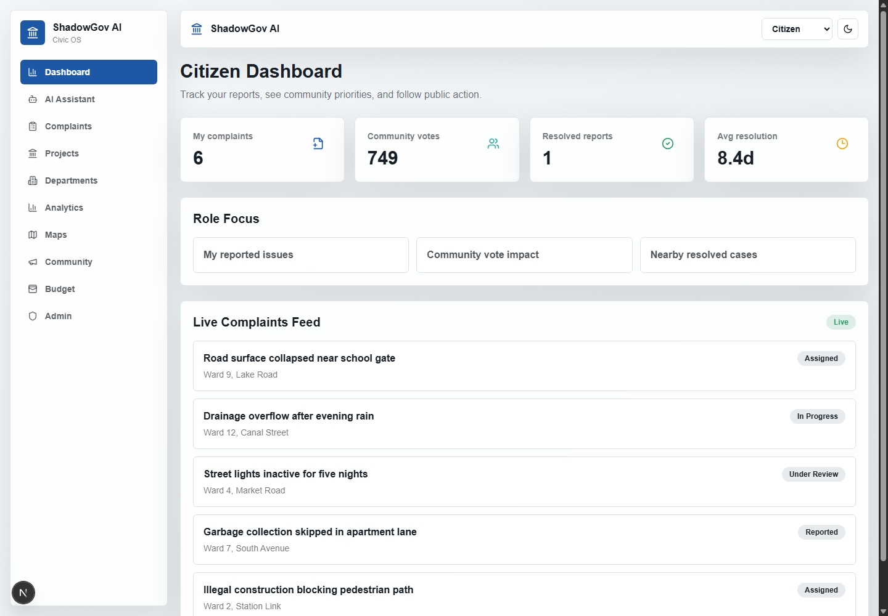
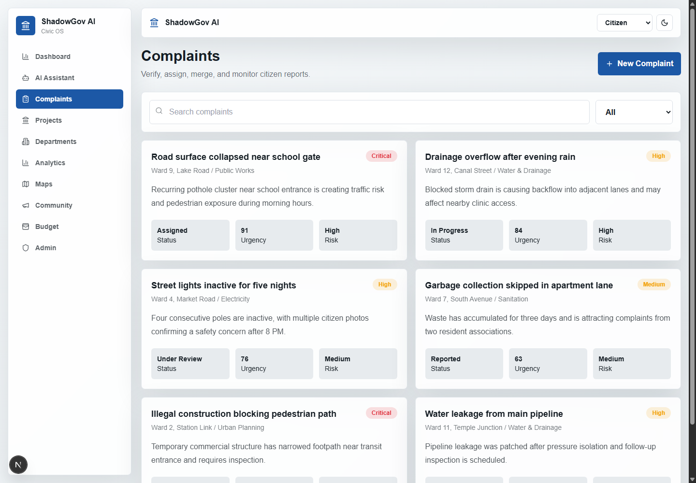
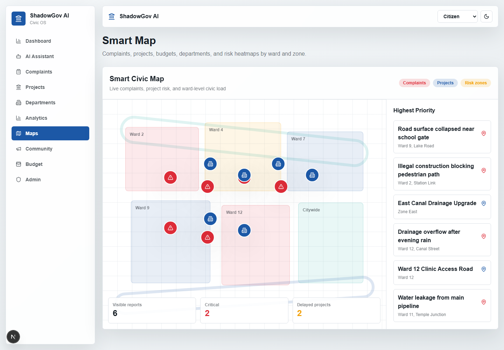
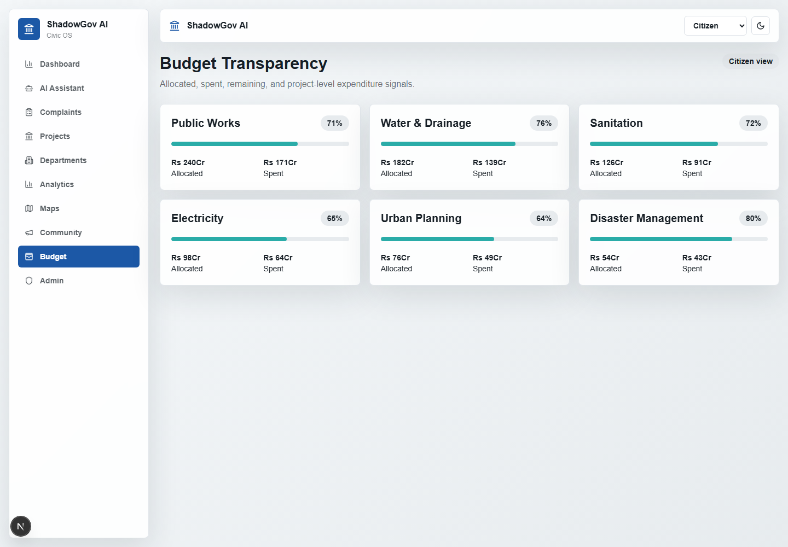
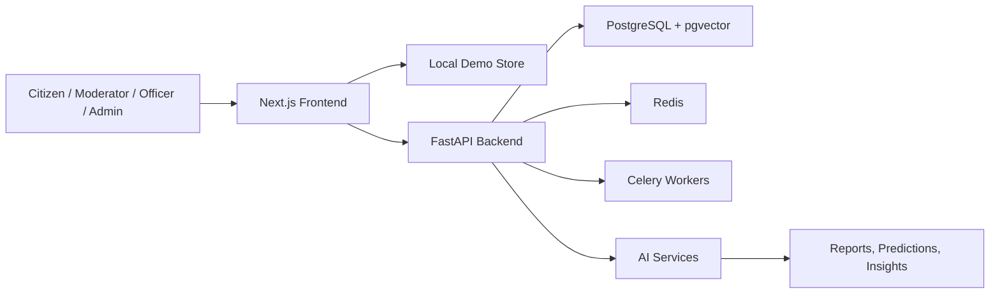
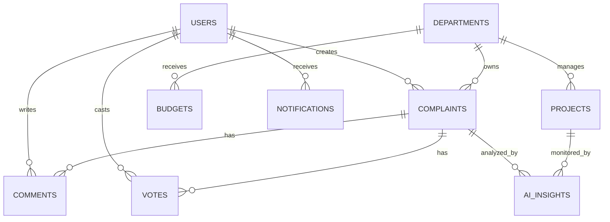

# ShadowGov AI

A civic transparency dashboard for tracking public complaints, government projects, budgets and department performance, with a map and an AI assistant.

## Why this exists
Information about local complaints, public works and spending is usually scattered and hard for citizens to follow. This is a working demo of one dashboard where citizens, moderators, officers and admins see the same data from their own role.

## What it does
- Role-based views for Citizen, Moderator, Officer and Admin (switchable locally for testing)
- Citizens file complaints; anyone can filter them by status or search text
- Officers create projects and create or edit budgets
- Civic map with ward zones, complaint and project pins, and risk zones
- Project table with progress, budget, status and risk score; department performance overview
- Charts for complaint trends and department load, and an AI assistant page for civic questions
- Dark mode; works on desktop and mobile

## Project structure
```
shadowgov-ai/
├── backend/
│   ├── app/core/      Settings
│   ├── app/db/        Database session
│   ├── app/services/  AI and domain services
│   ├── app/main.py    FastAPI app
│   ├── app/models.py  Database tables
│   ├── app/schemas.py Request and response models
│   └── seed.py        Demo data loader
├── frontend/
│   ├── app/           Dashboard, complaints, projects, budget, maps pages
│   ├── components/    UI components
│   └── lib/           State and API helpers
├── .github/           CI workflow
├── screenshot-*.png   UI screenshots
└── docker-compose.yml Local stack
```

## Getting started
Requirements: Node.js 18+; Python 3.11+ for the backend (optional for UI testing).
```bash
git clone https://github.com/abhijha8287/shadowgov-ai.git
cd shadowgov-ai
cp .env.example .env

cd frontend                                       # terminal 1
npm install
npm run dev                                       # http://localhost:3000

cd backend                                        # terminal 2 (optional)
python -m venv .venv && source .venv/bin/activate
pip install -r requirements.txt
python -m uvicorn app.main:app --reload --port 8000   # http://localhost:8000/docs
```
The frontend keeps demo data in browser storage, so it works without the backend.

## Tech stack
Next.js 15, React 19, TypeScript, Tailwind CSS, Zustand, React Query, Recharts, Python, FastAPI, SQLAlchemy, Pydantic, Docker

## Screenshots

### Dashboard



### Complaints



### Smart Map



### Budget



## How To Use The App

### Change User Role

Use the role dropdown in the top-right header.

Available roles:

- Citizen
- Moderator
- Officer
- Admin

Each role shows a different dashboard focus.

### Citizen

Citizens can:

- View their civic dashboard
- Create complaints
- Track complaint status
- View community reports
- Explore the civic map

### Moderator

Moderators can:

- Review reported complaints
- Focus on unverified and under-review reports
- Watch escalation candidates

### Officer

Officers can:

- Add new government projects
- Add new department budgets
- Edit existing budget allocation and spending
- Monitor assigned and high-risk work

### Admin

Admins can:

- See citywide performance
- Monitor departments
- Review projects, budgets, and analytics
- View system-level accountability signals

## Important Pages

```text
/dashboard       Role-based dashboard
/complaints      Complaint board
/complaints/new  Add a new complaint
/projects        Project monitoring and officer project creation
/budget          Budget transparency and officer budget editing
/maps            Smart civic map
/departments     Department leaderboard
/analytics       Charts and trends
/assistant       AI civic assistant
/admin           Admin overview
```

## Local Data Behavior

This demo uses browser storage through Zustand persistence.

That means:

- New complaints appear immediately in the complaints section.
- New officer projects appear immediately in the projects table.
- Budget edits appear immediately in the budget cards.
- Data can remain after refreshing the browser.

To reset local demo data, clear the browser site storage for `localhost`.

## API Highlights

The backend includes these API boundaries:

- `GET /health`
- `GET /api/complaints`
- `POST /api/complaints`
- `GET /api/projects`
- `GET /api/departments`
- `GET /api/analytics/overview`
- `POST /api/assistant/query`

## Environment Variables

Copy the example env file:

```bash
copy .env.example .env
```

On macOS/Linux:

```bash
cp .env.example .env
```

Then fill in real secrets only when you are connecting production services.

For local UI testing, the frontend can run without production secrets.

## Common Problems And Simple Fixes

### CSS Is Not Loading

Stop the dev server, delete the frontend build cache, and run it again:

```bash
cd frontend
rmdir /s /q .next
npm run dev
```

On macOS/Linux:

```bash
rm -rf .next
npm run dev
```

### Port 3000 Is Already Busy

Use another port:

```bash
npm run dev -- --port 3001
```

### PowerShell Blocks npm

Use `npm.cmd` instead:

```bash
npm.cmd run dev
```

### Backend Virtual Environment Does Not Activate

On Windows PowerShell, run:

```bash
Set-ExecutionPolicy -Scope Process -ExecutionPolicy Bypass
.venv\Scripts\activate
```

## Architecture



## Data Model Overview


